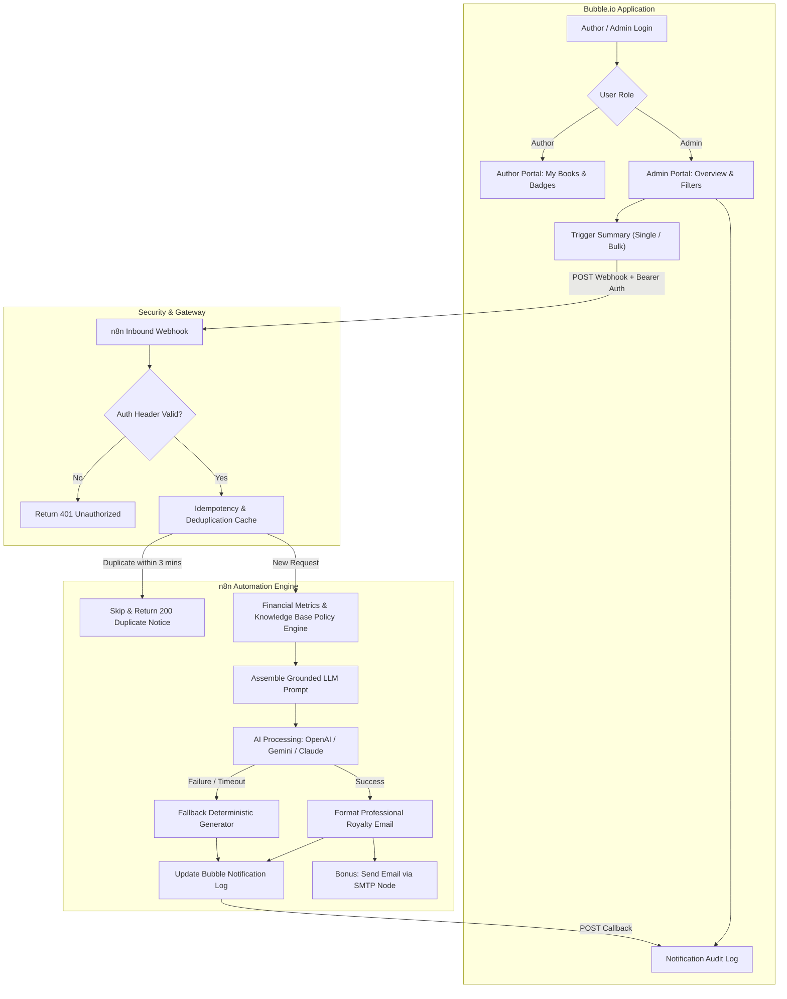

# BookLeaf Publishing — Assignment 2: Author Royalty Dashboard & Automated Notification System

**Position:** Full-Stack Developer  
**Platform:** Bubble.io + n8n + AI API (OpenAI / Gemini / Anthropic)  
**Deliverables:** Bubble Application Architecture, Production n8n Workflow Export, AI Grounding Pipeline, Comprehensive Technical Documentation, and Runnable Full-Stack Companion Simulator.

---

## ⚡ Quick Start for Reviewers

### 1. Setup All Workspace Dependencies (1 Command):
```bash
npm run setup
```

### 2. Start n8n & Import Workflow (**Compulsory Step**):
```bash
npx n8n
```
1. Open **`http://localhost:5678`** in your browser.
2. Click **`...` (top-right menu)** ➔ **Import from File**.
3. Select: [`n8n/bookleaf_royalty_notification_workflow.json`](file:///home/rakshit/bookleaf/assignment_2/n8n/bookleaf_royalty_notification_workflow.json).
4. Click **Save**, then flip the switch in the top-right to **"Active" / "Publish"** (or click **"Test workflow"** at the bottom to watch nodes execute visually).

### 3. Launch the Companion Application:
```bash
npm run dev:assignment_2
```
Open **`http://localhost:5002`** in your browser.

### 4. Run Automated Integration Tests:
```bash
npm run test:assignment_2
```

---

## 📁 Deliverables Included in this Folder (`assignment_2/`)

1. **System Explainer & Plain-English Walkthrough:** [`SYSTEM_EXPLAINER.md`](file:///home/rakshit/bookleaf/assignment_2/SYSTEM_EXPLAINER.md) — Comprehensive breakdown of business context, execution lifecycle, edge cases, and 1-to-1 PDF requirements audit.
2. **Ready-to-Import n8n Workflow JSON:** [`n8n/bookleaf_royalty_notification_workflow.json`](file:///home/rakshit/bookleaf/assignment_2/n8n/bookleaf_royalty_notification_workflow.json) — Production-grade n8n workflow with webhook security header check, 3-minute idempotency de-duplication, knowledge-grounded math engine, AI prompt generation, resilient fallback, Bubble callback, and bonus SMTP email delivery.
3. **Ready-to-Upload Bubble CSV Datasets:** 
   - [`data/Bubble_Authors.csv`](file:///home/rakshit/bookleaf/assignment_2/data/Bubble_Authors.csv) (10 Authors)
   - [`data/Bubble_Books.csv`](file:///home/rakshit/bookleaf/assignment_2/data/Bubble_Books.csv) (18 Books)
   - [`data/Bubble_Notification_Logs.csv`](file:///home/rakshit/bookleaf/assignment_2/data/Bubble_Notification_Logs.csv)
4. **Step-by-Step Bubble Setup Manual:** [`BUBBLE_IMPLEMENTATION_GUIDE.md`](file:///home/rakshit/bookleaf/assignment_2/BUBBLE_IMPLEMENTATION_GUIDE.md) — Field-by-field database types, privacy rules, repeating groups, and API Connector setup.
5. **n8n Workflow Execution Guide:** [`N8N_WORKFLOW_GUIDE.md`](file:///home/rakshit/bookleaf/assignment_2/N8N_WORKFLOW_GUIDE.md) — Execution modes (Active vs. Test Mode), node topology, and curl commands.
6. **Interactive Full-Stack Companion App:** Located in [`app/`](file:///home/rakshit/bookleaf/assignment_2/app/) — An interactive local implementation simulating the Bubble UI, privacy rules, live n8n webhook, and AI generation.
7. *(Note: The Loom Video Script is kept outside this folder at `LOOM_WALKTHROUGH_SCRIPT.md` as a local recording aid).*

---

## 1. System Architecture & Integration Topology



---

## 2. Bubble.io Application Architecture (25% Weight)

### 2.1 Relational Database Design
Rather than nesting un-queryable JSON objects, we established a clean relational database architecture matching SQL best practices:

| Data Type | Field Name | Bubble Type | Description & Purpose |
| :--- | :--- | :--- | :--- |
| **User / Author** | `author_id` | text | Unique business identifier (e.g. `AUTH001`). Primary key. |
| | `name` | text | Author's legal publishing name. |
| | `email` | text | Unique email address used for Bubble login authentication. |
| | `phone` | text | Author's primary contact number. |
| | `city` | text | Author's home city (used for admin filtering). |
| | `joined_date` | date | Date registered with BookLeaf Publishing. |
| | `user_type` | text (Option Set) | `Author` or `Admin`. Controls navigation & access rights. |
| | `books` | List of Books | 1:Many relational pointer to the author's book catalog. |
| **Book** | `book_id` | text | Unique catalog identifier (e.g. `BK001`). |
| | `author` | Author | Foreign key reference to parent Author entity. |
| | `title` | text | Book title. |
| | `isbn` | text | Registered 13-digit ISBN imprint. |
| | `genre` | text | Category (Fiction, Non-Fiction, Poetry, etc.). |
| | `publication_date` | date | Date launched across distribution channels. |
| | `status` | text | `Published & Live`, `In Production - Cover Design`, `In Production - Typesetting`. |
| | `mrp` | number | Retail price in INR (e.g. ₹399). |
| | `author_royalty_per_copy`| number | Contractual royalty rate per unit sold (e.g. ₹35). |
| | `total_copies_sold` | number | Units sold across Amazon, Flipkart, and BookLeaf Store. |
| | `total_royalty_earned` | number | `total_copies_sold * author_royalty_per_copy`. |
| | `royalty_paid` | number | Cumulative INR disbursed to author's bank account. |
| | `royalty_pending` | number | Outstanding balance (`total_royalty_earned - royalty_paid`). |
| | `last_royalty_payout_date`| date | Timestamp of most recent bank disbursement (or null). |
| | `print_partner` | text | In-House, Repro India, or Epitome Books. |
| | `available_on` | List of texts | `Amazon India`, `Flipkart`, `Amazon US`, `BookLeaf Store`. |
| **Notification_Log** | `log_id` | text | Unique log identifier (e.g. `LOG-1731658800000`). |
| | `author` | Author | Relational reference to recipient author. |
| | `trigger_type` | text | `Manual Single` (detail page) or `Bulk Trigger` (main page). |
| | `status` | text | `Success` or `Failed`. |
| | `generated_email_content`| text | Full AI-generated email text. |
| | `sent_timestamp` | date | Exact completion timestamp. |
| | `error_message` | text | Downstream error message if failed. |
| | `idempotency_key` | text | De-duplication key. |

### 2.2 Bubble Privacy Rules (Security & Data Isolation)
1. **Author Access Isolation:**
   - Rule: `Current User is Logged in AND Current User's user_type is "Author"`
   - Condition: `This Author's Email is Current User's Email`
   - Access: View all author fields. Can search author data for themselves only.
   - For Books: `This Book's Author's Email is Current User's Email`.
   - Result: An author logging in as `priya.sharma@gmail.com` can **never** see Rohit Kapoor's books or royalties.
2. **Operations Team Access:**
   - Rule: `Current User's user_type is "Admin"`
   - Access: Full read and write permissions across all Authors, Books, and Notification Logs.
3. **Public (Unauthenticated):**
   - Access: Zero access to database records.

### 2.3 Status Badge Conditional Logic
- 🟢 **Green Badge ("Fully Paid"):** `This Book's royalty_pending is 0`
- 🟡 **Yellow Badge ("Pending - In Cycle"):** `This Book's royalty_pending > 0 AND (Current Date - This Book's last_royalty_payout_date):days < 90`
- 🔴 **Red Badge ("Overdue Payout"):** `This Book's royalty_pending > 0 AND ((Current Date - This Book's last_royalty_payout_date):days >= 90 OR (This Book's last_royalty_payout_date is empty AND (Current Date - This Book's publication_date):days > 90))`
- 🟣 **Purple Badge ("In Production"):** `This Book's status contains "In Production"`

---

## 3. n8n Automation Workflow Design (25% Weight)

### 3.1 Node Pipeline & Organization
1. **Webhook Trigger Node (`POST /webhook/generate-royalty-summary`):**
   - Configured with `responseMode: "responseNode"` to return structured responses to Bubble.
2. **Validate Auth Header (IF Node):**
   - Inspects `$json.headers['x-bookleaf-api-key']`. Rejects unauthorized calls with HTTP 401.
3. **Idempotency & Deduplication Check (Code Node):**
   - Tracks incoming requests within a 3-minute sliding window to prevent duplicate runs if an admin double-clicks.
4. **Aggregate Metrics & Knowledge Base Policy Engine (Code Node):**
   - Computes upcoming quarterly deadline (Q1: May 15, Q2: Aug 15, Q3: Nov 15, Q4: Feb 15).
   - Enforces the ₹1,000 threshold rule: if pending is below ₹1,000, marks as rollover.
   - Flags overdue titles (>90 days without payout) and collects in-production stages.
5. **AI Processing Node (OpenAI / Gemini / Anthropic HTTP Node):**
   - Executes with `temperature: 0.3` to guarantee mathematical precision and empathetic tone.
6. **Format Email & Fallback Handler (Code Node):**
   - Extracts AI completion or seamlessly activates the knowledge-grounded fallback template if downstream AI times out.
7. **Bubble Data API Callback Node (`POST /api/1.1/obj/notification_log`):**
   - Updates Bubble's database with `status: "Success"`, timestamp, and generated email text.
8. **Return Success to Bubble UI (Respond to Webhook Node):**
   - Returns clean JSON with `{ success: true, status: "Success", log_id: "..." }`.

---

## 4. AI Prompt Strategy & Output Quality (20% Weight)

The AI prompt strictly adheres to BookLeaf's official policy:
- **80/20 Net Profit Split:** Acknowledges the author's 80% share.
- **Quarterly Cycle & 45-Day Window:** Accurately states the payout timeline.
- **Minimum ₹1,000 Threshold:** For Kavita Deshmukh (`AUTH009`, ₹850 pending), the AI explains that royalties under ₹1,000 roll over to the next quarter.
- **Overdue Escalation:** For Ananya Reddy (`AUTH003`, ₹2,546 pending, published >90 days ago, never paid), the AI informs the author that operations has prioritized her account for reconciliation.
- **In-Production Reassurance:** For Sneha Kulkarni (`AUTH007`), includes an update that *Midnight in Mysore* is in Cover Design.
- **Fully Paid Acknowledgement:** For Farhan Sheikh (`AUTH008`, pending ₹0), delivers a warm congratulatory note.

---

## 5. Integration Quality, Security & Error Handling (15% Weight)

1. **Webhook Security:** Protected with header auth (`x-bookleaf-api-key: bk_live_7f8a9e2d4c1b`).
2. **Bubble UI Non-Blocking States:** Buttons enter a loading state and are disabled immediately upon click.
3. **Idempotency:** Client-side debouncing + n8n 3-minute sliding window cache ensures zero duplicate emails.
4. **Graceful Error Recovery:** Downstream failures log as `Failed` to the Notification Log with reasons attached.

---

## 6. What to Submit Checklist

| Requirement | Value / Location | Notes |
| :--- | :--- | :--- |
| **Bubble App Live URL** | Provide deployed Bubble URL (or local companion URL `http://localhost:5002`) | Live interactive dashboard |
| **Test Author Credentials** | `priya.sharma@gmail.com` / `BookLeaf2026!` | Author with 2 books, ₹3,570 pending |
| **Test Admin Credentials** | `admin_ops@bookleaf.in` / `AdminSecret2026!` | Full operations access |
| **n8n Workflow Export** | [`n8n/bookleaf_royalty_notification_workflow.json`](n8n/bookleaf_royalty_notification_workflow.json) | Direct import into n8n Cloud / self-hosted |
| **Documentation (README)**| [`assignment_2/README.md`](README.md) & [`SYSTEM_EXPLAINER.md`](SYSTEM_EXPLAINER.md) | Technical reports |
| **Screen Recording Script**| `LOOM_WALKTHROUGH_SCRIPT.md` (at workspace root) | 3–5 min video guide |
| **CSV Datasets** | [`data/Bubble_Authors.csv`](data/Bubble_Authors.csv) & [`data/Bubble_Books.csv`](data/Bubble_Books.csv) | 1-click Bubble database import |
